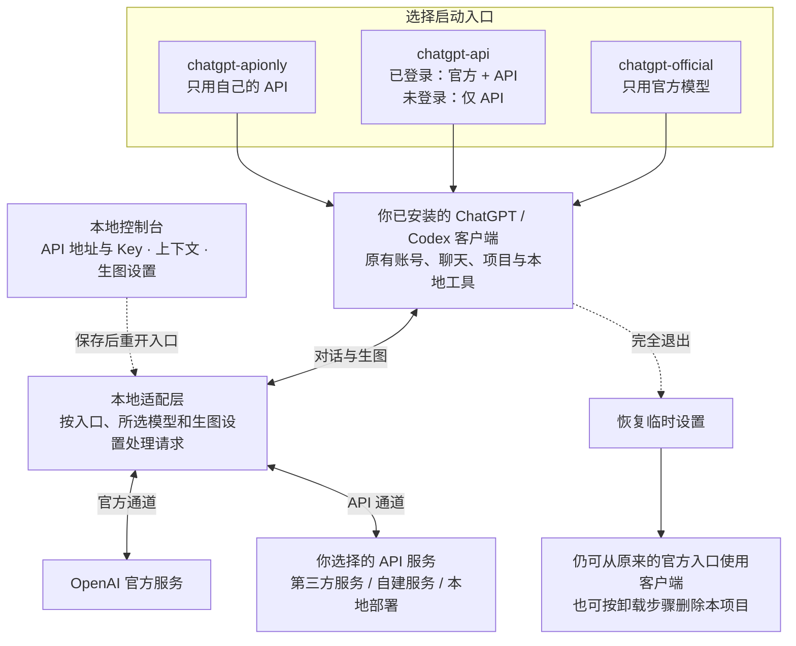

# ChatGPT API Launcher

### 在熟悉的官方客户端里，用你自己的 API

保留官方桌面客户端的原生界面、快捷键与交互质感，接入自定义模型。不想用了，退出后就能回到原来的使用方式。  
**原生界面与快捷键 · 官方 / 混合 / 纯 API · 同一对话切换模型 · 生图与本地工具**

[你的客户端照常保留](#你的客户端照常保留) · [核心优势](#核心优势) · [快速开始](#快速开始) · [三大启动模式详解](#三大启动模式详解) · [生图与视觉能力](#生图与视觉能力) · [本地控制台](#本地控制台) · [架构图](#架构图) · [停用与卸载](#停用与卸载) · [常见问题 (FAQ)](#常见问题-faq) · [与同类方案对比](#与同类方案对比)

---

## 你的客户端照常保留

ChatGPT API Launcher 是已有 **ChatGPT / Codex 官方客户端** 旁边的一组启动入口。安装后，你仍然使用自己原来的客户端，不需要换一套聊天软件，也不用搬运聊天记录。

- **不替换官方客户端，也不修改它的安装文件**  
  原来的客户端可执行程序、`app.asar` 和官方启动入口继续保留，没有任何修改。
- **保留原有账号、语言、界面偏好和项目分类**  
  配置自定义 API 不需要预先退出官方账号；纯 API 模式下，也无需为模型推理登录官方账号。
- **用完随时可以回原版**  
  完全退出客户端后，启动器会自动恢复本次使用涉及的所有临时设置。之后仍可直接从原来的官方入口打开客户端，按原来的方式登录和使用。
- **不用了可以干净删除**  
  先正常退出并确认原版能够正常打开，直接删除本项目的启动器、控制台和安装目录即可。不需要重装官方客户端，也不需要清空它的本地聊天记录。

官方客户端本身的安装和更新仍按官方方式进行。客户端更新后，启动器有时也需要更新兼容版本。

> [!NOTE]
> **原版客户端可以继续使用，不代表所有 API 对话都能直接带回原版续聊。**  
> 部分通过 API 创建或混用过模型的对话，仍需通过本项目的兼容入口才能继续。删除启动器不会删除这些记录，但也会停用这项兼容支持。详见 [历史对话会怎样](#历史对话会怎样)。

---

## 核心优势

- **在官方界面里用自己的模型**  
  继续使用熟悉的聊天界面、快捷键、文件拖拽和项目管理。自由接入提供兼容 API 的 DeepSeek、Claude、Gemini、通义千问等模型，亦可直接使用自建服务或本地部署（Ollama / vLLM）。
- **同一对话中切换官方与 API 模型**  
  已有官方账号时，模型菜单可以同时显示官方模型和你的 API 模型。根据任务难度随心选择合适的模型，不必为了换模型频繁重新建对话。（*注：图片、附件和已压缩的旧对话仍受相应能力限制*）
- **官方额度用完，切自己的 API 接着聊**  
  当前 3.2.2 支持在官方额度耗尽后切到自定义模型继续发送。使用的是你自己的 API 额度，不会增加或改变官方账号的实际额度。
- **多个 API 统一集中管理**  
  最多可添加 32 个来源，分别命名、启用或停用。模型列表带有来源名称标注，同名模型也会分开显示，方便明确选择对应的服务。
- **保留原有对话和项目分类**  
  通过本项目的三个入口切换使用时，继续沿用原来的聊天记录、项目归属和分类映射。原有消息完整保留，不为切换入口另建一份外置聊天库。
- **继续使用客户端提供的工具**  
  可配合客户端已有的本地文件处理、终端等工具，也能完整展示服务商实际返回的思考（Reasoning / Thinking）内容。具体能用哪些工具，取决于客户端、系统权限和所选模型的能力。
- **聊天、生图和参数设置集中管理**  
  在本地控制台集中管理 API 来源、默认图片模型、画质、图片思考强度及上下文上限。支持的 GPT 模型可使用客户端里的 Fast（小闪电）选项，实际优先服务由 API 提供方决定。
- **按步骤安装，无需准备开发环境**  
  发布包全平台自带运行所需组件（内置独立轻量 Node 运行时）。安装后填写 URL 和 Key 即可使用，也可以先跳过配置，之后再随时补充。

---

## 快速开始

### 1. 下载发布包

> [!NOTE]
> 本工具运行需要先有可运行的 **ChatGPT / Codex 桌面客户端**，本项目不包含客户端本体。Windows、macOS 提供三个聊天入口；Linux 仅提供纯 API 模式和控制台。

| 平台 | 下载地址 | 安装说明 |
| :--- | :--- | :--- |
| **Windows x64** | [ChatGPT-API-Launcher-3.2.2-win-x64.zip](https://github.com/bolifa556/ChatGPT-API/releases/download/v3.2.2/ChatGPT-API-Launcher-3.2.2-win-x64.zip) | 解压后双击运行 `安装.cmd`，按提示选择安装目录完成安装。 |
| **macOS (Apple Silicon)** | [ChatGPT-API-Provider-3.2.2-macos-arm64.dmg](https://github.com/bolifa556/ChatGPT-API/releases/download/v3.2.2/ChatGPT-API-Provider-3.2.2-macos-arm64.dmg) | 打开 DMG，将需要的启动入口与控制台 App 拖到“应用程序”。首次打开被系统拦截时，按 [macOS 说明](docs/macos-dmg-readme.md) 中的步骤允许打开。 |
| **Linux x64** | [ChatGPT-API-Provider-3.2.2-linux-x64.tar.gz](https://github.com/bolifa556/ChatGPT-API/releases/download/v3.2.2/ChatGPT-API-Provider-3.2.2-linux-x64.tar.gz) | 解压后，以桌面用户身份运行 `./install.sh`。（详见 [Linux 说明](docs/linux-readme.md)） |
| **Linux ARM64** | [ChatGPT-API-Provider-3.2.2-linux-arm64.tar.gz](https://github.com/bolifa556/ChatGPT-API/releases/download/v3.2.2/ChatGPT-API-Provider-3.2.2-linux-arm64.tar.gz) | 解压后同样运行 `./install.sh` 即可。 |

### 2. 填写自己的 API

安装时可以选择 **“跳过，稍后配置”**，先完成安装。已有的 API 设置会保留；只使用官方入口时，无需填写 API。

安装完成后，打开 **本地控制台**（Windows 双击程序目录下的 `控制台.vbs`）：
1. 在 **API 来源** 页面添加来源，填写名称、Base URL 和 API Key。
2. 点击 **保存**，进入 **模型与上下文** 页面，点击右上方的 **刷新模型目录**。
3. 查看可用模型。需要生图时，确认列表中有图片模型；发现后会自动选好默认项，也可自己更换。
4. 完全退出客户端，再从需要的入口打开使用。

> [!TIP]
> 请使用服务商提供的 OpenAI 兼容地址。不同服务的兼容范围不完全相同，能显示模型不一定代表所有功能都可用。使用不需要鉴权的本地服务时，Key 栏目前也需要填写非空占位值。

### 3. 选择入口

Windows、macOS 安装后，可按下面的场景选择入口。切换不同入口前，请先完全退出客户端，包括 Windows 系统托盘中的后台实例。

---

## 三大启动模式详解

| 启动入口 | 适合什么情况 | 使用效果 |
| :--- | :--- | :--- |
| **`chatgpt-official`** | 只用官方账号和官方模型，同时希望继续兼容之前的 API 对话 | 保留官方登录，只提供官方模型，不需要填写 API。这里是本项目的官方兼容入口，与直接打开客户端本体有所区别。 |
| **`chatgpt-api`** | 官方订阅与自己的 API 一起用 | 已登录时，菜单合并官方与 API 模型，可在同一对话中切换。没有官方登录时只使用 API。 **官方额度耗尽后，可切自定义模型继续发送。** |
| **`chatgpt-apionly`** (Linux 名称: `ChatGPT API`) | 只使用自己的 API，不通过官方订阅调用模型 | 无论是否保存了官方登录，聊天和生图都使用自己的 API，模型菜单也只显示 API 模型。 |

- Windows、macOS 会分别记住各入口上次选择的可用模型。
- 语言、界面偏好和项目分类仍沿用原来的客户端设置。
- **如果只是想停用本项目，完全退出后直接从原来的官方入口打开即可，不必一直使用这些新增入口。**

---

## 生图与视觉能力

有可用的图片服务时，可以继续在聊天里让模型画图、查看结果，或围绕图片继续交流。

### 自动识别与默认选用（不用先研究该选哪个图片模型）
在控制台刷新模型目录后，能识别到的图片模型会放进 **模型与上下文** 列表，并自动选好默认生图模型。如果想换一个，勾选另一个模型的默认项，保存后重开入口即可。

> [!NOTE]
> 当前需要在控制台更换默认生图模型。仅在聊天文字里说“用某某模型画图”，不能可靠地切换图片模型。

### 官方图片服务与自己的 API 都能选
控制台提供 **官方生图设置** 和 **自定义生图设置**：
- **官方生图设置**：使用已登录账号的官方图片服务。官方服务出错时会显示原错误，不自动改用自己的 API。
- **自定义生图设置**：使用列表里选中的默认 API 图片模型，可调整该模型支持的画质和思考强度。
- 纯 API 入口始终使用自定义图片服务，官方入口始终使用官方图片服务。

### 生图后可以继续聊，也可以修图
- **原对话无缝追问**：生成结果可在原对话中继续使用，不必为了追问重新开一段聊天。继续识图或修改图片，需要聊天模型、图片模型和所用服务提供相应能力。
- **图片格式与动图**：支持处理 PNG、JPEG、WebP，也会保留图片服务实际返回的 GIF 原文件。
- **能力边界说明**：是否能够生成 GIF，取决于所用服务，不能仅凭支持保存 GIF 就认为一定能生成动图。不同服务对型号和画质的支持可能不同，最终结果以服务商实际提供的能力为准。

---

## 本地控制台

控制台只在本机打开，用来管理自己的 API 和模型，不需要另装一个管理应用。

| 平台 | 打开方式 | 默认安装位置 |
| :--- | :--- | :--- |
| **Windows** | 程序目录下的 `控制台.vbs` | `%LOCALAPPDATA%\Programs\ChatGPT-API-Launcher` |
| **macOS** | `chatgpt-console.app`，或程序目录中的 `控制台.command` | `~/Library/Application Support/chatgpt-apionly` |
| **Linux** | 程序目录中的 `控制台.desktop`，或应用菜单中的 **ChatGPT API 控制台** | `~/.local/share/chatgpt-api-provider` |

### 在控制台里可以执行的操作
- **管理 API 来源**：添加多个 API，修改名称、地址和 Key，按需要启用或停用。
- **刷新模型目录**：查看各来源能提供哪些模型，并支持手动刷新目录。
- **配置生图偏好**：选择默认生图模型，以及该模型可用的画质和思考强度。缺少能力信息时会标为“无法检测”。
- **精细调整上下文**：调整全局或单模型的上下文上限。默认上限为 500,000 tokens，客户端通常显示约 475k；可设置为 4,096 至 2,000,000，但不会超过已知的模型容量。
- **密钥安全脱敏**：用密码圆点遮住已保存的 Key，需要查看时点击眼睛按钮即可。

### 缓存与自动退出机制
- **24 小时本地缓存**：模型目录会保留最近 24 小时内的有效记录，来源临时无法刷新时可继续使用这份菜单；真正发消息仍需 API 服务可用。本项目不会在运行期间定时刷新模型目录。
- **无感退出**：关闭最后一个控制台页面后，控制台服务会在数秒内退出。客户端仍在使用时，聊天所需的后台服务会继续运行；完全退出客户端后再结束。

> [!TIP]
> 修改设置或刷新目录后，请完全退出客户端，再打开对应入口，让客户端加载新设置。

---

## 架构图

三个入口使用的都是你已安装的官方客户端。模型和图片服务按当前选择使用，原来的聊天、项目与界面设置继续保留。

Windows、macOS 提供三个入口，Linux 使用纯 API 模式。官方入口只使用官方服务，纯 API 入口只使用自己的 API；混合入口的生图来源还可在控制台选择。

---

## 停用与卸载

### 暂时不用，直接回原版
1. 完全退出客户端，包括托盘中的后台实例。
2. 从你原来使用的官方入口打开客户端。
3. 继续按原来的方式使用。API 设置仍保留在本项目中，以后需要时再打开对应入口即可。

**不需要重新安装官方客户端，也不需要为了停用本项目而退出账号、清空聊天或重建项目。**

### 不再使用，可以删除启动器
1. 先完全退出客户端和控制台。
2. 从原来的官方入口打开一次，确认能够正常打开，再退出。
3. 删除本项目新增的启动入口、控制台和安装目录即可。macOS 用户可同时移除拖入“应用程序”的这几个启动器 App。

**安全提醒与注意事项：**
- **备份配置**：想保留 API 设置，可以先备份本项目安装目录中的 `data` 文件夹；里面可能有明文 Key，请勿公开分享。不准备再用时，可以连同本项目目录一起删除。
- **独立性保障**：只删除本项目，不需要删除官方客户端，也不要清理官方客户端自己的聊天和登录数据。删除本项目不会顺带删除保存在原客户端中的聊天记录。
- **异常恢复建议**：如果此前遇到突然关机、强制结束或恢复失败提示，先保留安装目录，重新打开本项目的一个入口并正常退出，确认原来的官方入口能够正常打开后再删除。

### 历史对话会怎样？
- 原来通过官方入口创建、且仍符合原版使用要求的对话，可以继续按原来的方式使用。
- 通过 API 创建或混用过模型的部分对话，回到原版后可能无法直接续聊。
- 这些记录不会因为删除启动器而被删除，但卸载后也不会再有本项目的旧对话兼容功能。如果需要继续使用这类对话，可以保留 `chatgpt-official` 兼容入口；决定彻底删除前，先确认需要保留的内容。

---

## 常见问题 (FAQ)

<b>Q1: 一定要登录官方账号吗？</b>

> 使用自己的 API 聊天、生图，不要求登录官方账号，选择 `chatgpt-apionly` 即可。使用官方订阅模型时仍需官方登录。部分浏览器扩展、语音等服务也可能另外要求官方账号权限，模型 API Key 不能代替这些权限。

<b>Q2: 官方额度用完，还能用自己的 API 吗？</b>

> 可以。当前 3.2.2 支持在 `chatgpt-api` 中切到自定义模型继续发送，或完全退出后从纯 API 入口使用。需要你的 API 自身仍可用；权限、任务状态等其他发送限制仍然有效。

<b>Q3: 用过 API 后，原来的客户端还能独立使用吗？</b>

> 可以。完全退出后，临时设置会恢复，原来的客户端仍可照常打开和使用，不必继续运行本项目。部分 API 对话的续聊有单独限制，详见 [历史对话会怎样](#历史对话会怎样)。

<b>Q4: 为什么有些模型不能识图、用工具或生成图片？</b>

> 这些能力需要客户端、模型和 API 服务共同支持。能列出模型、能普通聊天，不代表一定支持全部工具或图片功能。切换模型不会让它获得本来没有的能力。

<b>Q5: 历史对话切换模型后，一定都能接着聊吗？</b>

> 普通对话可以在本项目的兼容入口中切换模型。已被官方压缩过的部分对话，或含有其他服务无法读取的附件，切换到非 GPT 模型时可能受限。官方兼容入口沿用官方压缩，两个 API 入口使用客户端的文字摘要压缩，具体区别见技术文档。

<b>Q6: 我的 API Key 会发到哪里？</b>

> 配置保存在本机，发起请求时，对应 Key 会用于向你选中的 API 服务认证。Key 在本地配置中是明文保存的，密码圆点只负责遮挡显示。分享本项目时，请分享原始发布包，不要分享自己已经填写过 Key 的安装目录。

<b>Q7: 所有标注“OpenAI 兼容”的 API 都能用吗？</b>

> 不一定。服务商需要提供本项目支持的模型目录和对话接口；生图、编辑、工具调用等还需各自的接口支持。仅提供部分兼容接口的服务，可能还需要服务商调整。具体接口要求见 [配置说明](docs/configuration.md)，本地部署也需要满足同样的要求。

---

## 与同类方案对比

可以按自己最需要的功能选择：

| 项目 | 更适合哪些需求 |
| :--- | :--- |
| **本项目** | 继续使用自己的官方客户端，增加官方、混合、纯 API 三种入口，在同一份聊天与项目中使用不同模型，并可随时停用。 |
| **[Codex++](https://github.com/BigPizzaV3/CodexPlusPlus)** | 希望统一管理多个 Agent，使用扩展、界面增强和本地网关。 |
| **[OpenCodex](https://github.com/lidge-jun/opencodex)** | 希望让 Codex、Claude Code 等多个客户端共用模型服务。 |
| **[CC Switch](https://github.com/farion1231/cc-switch)** | 希望集中切换各工具的供应商，并管理 MCP、Skills 和提示词配置。 |

---

## 更多文档

- [macOS 安装与更新](docs/macos-dmg-readme.md)
- [Linux 安装与使用](docs/linux-readme.md)
- [控制台使用说明](docs/console.md)
- [技术架构与协议机制](docs/architecture.md)
- [技术文档索引](docs/README.md)
- [开发与构建](docs/maintenance.md)

---

## 免责声明

- 本项目为独立的第三方开源工具，仅供技术交流与个人学习使用，不包含也不分发任何 OpenAI 官方客户端软件。
- “ChatGPT”、“OpenAI”及相关标识均为其原权利人所有。
- 请遵守相关 API 供应商的服务条款及所在地法律法规。

---

  如果这个项目改善了你的桌面使用体验，欢迎在 GitHub 上点亮一颗 ⭐️ Star 支持一下！

