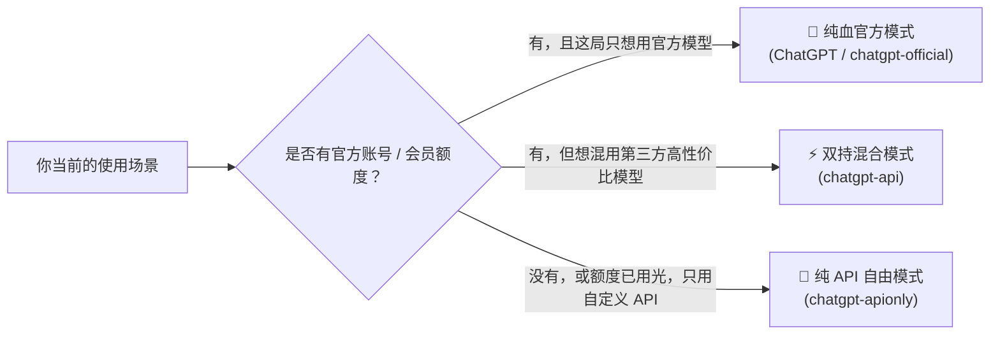
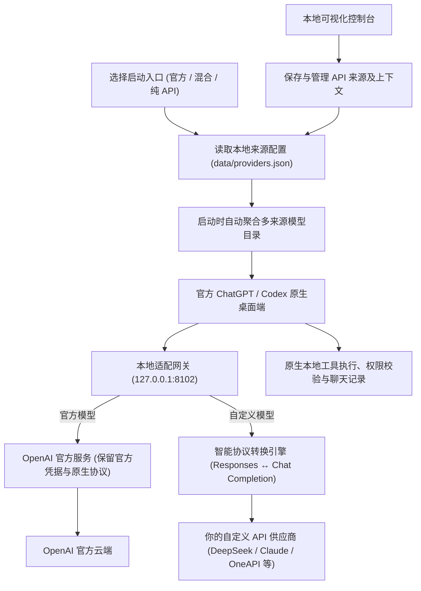

<div align="center">

# 🚀 ChatGPT API Launcher

### 让原汁原味的官方 ChatGPT 桌面端，无缝接入任意第三方大模型！

支持接入 **DeepSeek** · **Claude** · **Gemini** · **OpenAI 全系/中转** · **本地 Ollama / vLLM** 与任意兼容 API  
**原版丝滑体验 · 零修改客户端 · 三种灵活模式 · 深度思考与生图全面适配**

[](release/README.md)
[](#-极速上手)
[-success.svg)](#-核心特性与优势)
[](#-极速上手)

[安装指南](#-极速上手) · [三大模式怎么选](#-三大启动模式怎么选) · [控制台指南](#-本地可视化控制台) · [同类对比](#-为什么选择本项目与同类项目对比) · [常见问题 (FAQ)](#-常见问题与温馨提示-faq) · [技术文档索引](docs/README.md)

</div>

---

## 💡 为什么需要它？

官方原版的 **ChatGPT / Codex 桌面客户端** 拥有极其优雅丝滑的交互质感、全局快捷键、原生工具链与文件交互能力，但痛点也很明显：
- ❌ **被官方单一生态绑死**：无法自由接入各家性价比更高、推理更强的新一代顶尖大模型（如满血 DeepSeek 全系推理与通用模型、Claude 最新旗舰、Google Gemini、通义千问/Kimi，或本地部署的私有开源模型）；
- ❌ **官方账号额度容易受限**：一旦用完官方额度，输入框直接被锁死，只能苦等重置；
- ❌ **第三方套壳客户端体验粗糙**：市面上的 Web 套壳应用往往缺乏原生客户端的精致细节、快捷键和动画质感；
- ❌ **暴力破解工具风险高**：很多工具通过反编译修改 `app.asar` 或注入 CDP，容易损坏文件、报毒或者每次客户端官方更新就直接失效。

> **ChatGPT API Launcher** 就是为了终结这一切而生！  
> **无需修改官方客户端的一行代码**，通过本地轻量级透明适配网关，在完整保留原版客户端所有交互、快捷键、历史记录和工具的前提下，让你随心所欲调用任意大模型！

---

## ✨ 核心特性与优势

- 🛡️ **纯粹透明，零代码侵入**  
  不改写 `app.asar`、不反编译、不注入任何代码、不触碰客户端二进制文件。纯绿色本地代理架构，随时可无痕还原，绝不损坏官方程序。

- 🔀 **三大模式，按需随心切换**  
  提供「官方纯血模式」、「双持混合模式」与「纯 API 自由模式」。不管是官方会员想要偶尔换口味，还是没有官方账号想白嫖原生桌面 UI，都能一键满足。

- 🌐 **多 API 供应商统一聚合**  
  支持同时配置多达 32 个 API 来源（如 DeepSeek 官方、硅基流动、OpenRouter、自建 OneAPI/NewAPI、本地 Ollama 等），统一聚合到同一个模型下拉菜单中。来源智能前缀隔离，同名模型清晰标注，绝不串号、绝不串路由。

- 🧠 **真·全协议深度转换引擎**  
  官方桌面端使用的是内部私有复杂的 Responses 协议。本项目内置双向转换引擎：完美支持 **DeepSeek、Claude、OpenAI 等全系推理模型的深度思维链展开（Reasoning Content）**，原生折叠展开无缝呈现；全面支持本地工具调用（Tool Calling）、图片生成/编辑与原生打断（Interrupt）。

- 📈 **海量上下文自由掌控**  
  原生支持 500,000 ~ 2,000,000 的超大上下文容量调节，长文档处理与超大代码库问答轻松应对，智能容量感知与缓存，不浪费一次重复探测。

- 🎛️ **开箱即用可视化控制台**  
  自带极简美观的本地 Web 控制台，点点鼠标就能添加/启停 API 来源、刷新模型列表、调节上下文上限与指定生图模型。密钥本地安全存储，杜绝泄露。

- 📦 **全平台内置绿色运行时**  
  Windows、macOS (Apple Silicon)、Linux 全部打包自带独立轻量 Node.js 运行时，解压/拖拽即用，**你的电脑不需要配置任何开发环境！**

---

## 🚀 极速上手

### 1. 下载发布包

> [!NOTE]  
> 请先确保已从 OpenAI 官网安装对应平台的**官方 ChatGPT / Codex 桌面客户端**。

| 平台 | 下载发布包 | 极速安装方式 |
| :--- | :--- | :--- |
| **Windows x64** | [ChatGPT-API-Launcher-3.1.6-win-x64.zip](https://github.com/bolifa556/ChatGPT-API/releases/download/v3.1.6/ChatGPT-API-Launcher-3.1.6-win-x64.zip) | 完整解压后双击运行 `安装.cmd`，选择程序目录完成安装。 |
| **macOS (Apple Silicon)** | [ChatGPT-API-Provider-3.1.6-macos-arm64.dmg](https://github.com/bolifa556/ChatGPT-API/releases/download/v3.1.6/ChatGPT-API-Provider-3.1.6-macos-arm64.dmg) | 打开 DMG 镜像，将对应的启动入口与控制台 App 拖到“应用程序”文件夹。（详见 [macOS 说明](docs/macos-dmg-readme.md)） |
| **Linux x64** | [ChatGPT-API-Provider-3.1.6-linux-x64.tar.gz](https://github.com/bolifa556/ChatGPT-API/releases/download/v3.1.6/ChatGPT-API-Provider-3.1.6-linux-x64.tar.gz) | 解压压缩包，以桌面用户身份执行 `./install.sh`。（详见 [Linux 说明](docs/linux-readme.md)） |
| **Linux ARM64** | [ChatGPT-API-Provider-3.1.6-linux-arm64.tar.gz](https://github.com/bolifa556/ChatGPT-API/releases/download/v3.1.6/ChatGPT-API-Provider-3.1.6-linux-arm64.tar.gz) | 解压后同样执行 `./install.sh` 即可。 |

### 2. 配置你的 API 来源

> [!TIP]
> 安装时可以选择 **“跳过，稍后配置”**，先完成安装；已有 URL 和 Key 不会被覆盖。未配置 API 就打开 API 入口时，会提示通过控制台填写。Windows / macOS 的官方入口无需填写 API。

安装完成后，打开 **本地控制台**（Windows 双击程序目录中的 `控制台.vbs`）：
1. 在 **API 来源** 页面点击“添加来源”，填写名称、API Base URL 和 API Key（例如接入 DeepSeek、OpenRouter 或自己的中转站）；
2. 点击 **保存**，然后点击 **刷新模型目录**，查看所有可用模型是否已被顺利识别；
3. （可选）在 **模型与上下文** 页面微调上下文上限与图片模型。

### 3. 选择合适入口，开箱畅玩！

根据你的需求，在桌面或程序目录双击对应的启动入口即可开始使用！（详见下方模式说明）

---

## 💡 三大启动模式怎么选？

为了兼顾各种不同的使用场景，本项目精心设计了三个独立的启动入口。**它们完全共享官方客户端的原生功能和历史记录**，你可以根据当前需求随时切换：



| 启动入口 | 适合人群与场景 | 实际运行机制 |
| :--- | :--- | :--- |
| **`ChatGPT`** (Win)<br>`chatgpt-official` (Mac) | **官方忠实党**<br>适合只想安心使用 OpenAI 原版服务，不需要任何第三方 API 的时候。 | 完全走官方原生登录与官方通道，保留处理混合历史的兼容逻辑，完全原汁原味。 |
| **`chatgpt-api`** | **双持党 / 进阶用户**<br>既有官方账号，又想在下拉菜单里随时切换到 DeepSeek、Claude、Gemini、通义千问等各家前沿顶尖模型。 | **智能合并菜单**：下拉列表同时显示官方模型与你添加的全部 API 模型。选官方模型走 OpenAI 官方通道，选自定义模型自动走对应的 API 代理。 |
| **`chatgpt-apionly`**<br>(Linux: `ChatGPT API`) | **纯 API 党 / 白嫖党 / 效率党**<br>没有官方付费订阅，或者官方额度用尽，只想把官方客户端当作终极原生 UI 跑自己的 API。 | **彻底摆脱官方账号限制**！无论是否登录官方账号，模型目录、对话生成与绘图全部强制使用自定义 API，零门槛尽情使用！ |

> [!TIP]
> 切换不同的启动入口前，请先完全退出 ChatGPT 客户端（Windows 请检查右下角系统托盘是否完全退出）。每个入口都会分别记住你上次选中的模型。

---

## 🎛️ 本地可视化控制台

控制台随安装包自带，基于 Node 内置轻量服务，**纯本地运行，免安装任何前端环境**。

| 平台 | 控制台打开位置 | 默认安装目录 |
| :--- | :--- | :--- |
| **Windows** | 安装目录下的 `控制台.vbs` | `%LOCALAPPDATA%\Programs\ChatGPT-API-Launcher` |
| **macOS** | `chatgpt-console.app`，或程序目录 `控制台.command` | `~/Library/Application Support/chatgpt-apionly` |
| **Linux** | 安装目录 `控制台.desktop` 或应用菜单的 **ChatGPT API 控制台** | `~/.local/share/chatgpt-api-provider` |

### 控制台使用亮点
- **多渠道独立隔离**：支持最多 32 个 API 来源，每个来源独立保存、独立开关。一个来源出现网络抖动绝不会拖垮其他可用来源。
- **智能名称防冲突**：不同来源若有同名模型，会自动附带来源标签（如 `@DeepSeek/deepseek-chat`），路由精准投递，绝不会偷偷串号。
- **高安全级别**：API Key 仅保存在本机配置文件，前端不回显已保存的明文；服务仅监听本地回环地址（127.0.0.1）并附带随机 Token 校验，避免局域网越权。
- **多层降级缓存**：每个来源独立缓存 24 小时内的模型列表，偶尔断网也能从本地缓存加载历史模型列表。

---

## 📊 为什么选择本项目？（与同类项目对比）

社区中有一些出色的同类尝试，但各自的定位与设计理念存在明显差异：

| 对比维度 | **本项目 (ChatGPT API Launcher)** | **Codex++** | **OpenCodex** | **CC Switch** |
| :--- | :--- | :--- | :--- | :--- |
| **客户端改造程度** | **零侵入、零修改**（纯本地透明网络适配） | 基于 Rust/Tauri，通过 CDP 注入管理 | 本地多协议代理 | 基于 Tauri 的多客户端管理器 |
| **界面体验** | **100% 官方原版桌面端原生质感** | 定制增强型窗口与界面 | 偏向跨应用服务 | 偏向管理面板与配置切换 |
| **启动自由度** | **独创三大入口**（官方 / 混合双持 / 纯 API 免登录） | 侧重单一管理入口 | 侧重作为 Provider 后端 | 偏向供应商与提示词切换 |
| **运行环境要求** | **解压即用**（发布包内置极简独立 Node 运行时） | 需安装对应桌面管理应用 | 需独立配置运行环境 | 需安装独立管理桌面端 |
| **思维链支持** | **原生级支持**（DeepSeek / o 系列 / Claude 等各家推理模型的思维链原生折叠与展开） | 支持 | 支持 | 视下游客户端而定 |
| **核心定位** | **为追求原汁原味官方客户端质感的用户提供最纯净、最稳妥的 API 接入方案** | 适合追求丰富扩展、界面深度定制的高级玩家 | 适合需要同时桥接 Claude Code / Grok 等多个客户端的开发者 | 适合需要统一管理 MCP、Skills、Prompt 配置的用户 |

---

## 📐 架构原理

本项目采用高效、低延迟的**本地透明路由网关架构**。启动客户端时，启动脚本仅通过客户端支持的本地端口引导网络流，所有消息在内存中完成无缝转换，不破坏磁盘上的客户端结构：



- **官方模型**：直接走官方原有协议与身份验证，原汁原味。
- **自定义模型**：自动将官方 Responses 私有消息转换为标准 OpenAI Chat 协议；同时将思维链、工具调用（Function Calling）、图片生成结果无缝还原给客户端。
- **数据完全本地**：你的登录凭据、聊天记录继续安全地保存在官方客户端原生数据库中。

---

## ⚠️ 当前局限与兼容边界

> [!IMPORTANT]
> 本项目负责消息格式转换，**不能保证所有对话、模型和官方功能在不同入口间完全互通**。使用前请留意以下边界。

<details>
<summary><b>🔄 用自己的 API 聊过，再从官方入口打开，能接着聊吗？</b></summary>

> **部分旧对话可能无法继续发送、恢复或压缩，不能保证无缝切回。**  
> 自定义模型的消息、工具记录和对话 provider 状态，可能与官方模型当前要求不同。本项目的 **`ChatGPT / chatgpt-official` 兼容入口** 会处理必要的历史格式，但仍有兼容边界；直接打开未经过本项目兼容层的原版客户端，也不会获得这部分处理。
>
> **遇到无法继续时**：优先从原 API 入口使用原模型继续；如果仍然失败，建议新建官方对话，并由你自行补充需要的上下文。不要将“共享聊天列表”理解为任意历史都能跨入口续聊。
</details>

<details>
<summary><b>🗜️ 换模型后，压缩和上下文一定能同步吗？</b></summary>

> **不一定。** 官方 / API 模型切换后，部分原生 provider 与压缩方式需要 **完全退出并重新打开入口** 才能同步。官方加密思考和加密压缩块不能被其他厂商模型解密；缺少可读历史时会明确报错，不会偷偷编造摘要或丢弃上下文。
>
> 模型菜单和上下文设置也在重开后加载，用量浮窗随客户端新一轮统计刷新。设置更大的窗口不会增加上游模型的实际容量。
</details>

<details>
<summary><b>🌐 只有 API Key，能使用全部浏览器、插件和语音功能吗？</b></summary>

> **不能保证。** 纯 API 模式只改变模型请求的来源，不能替代原生浏览器扩展、部分在线工具、插件或语音服务要求的 **官方身份、平台权限与网络连接**。例如 Edge / Chrome 控制若依赖官方身份接口，仅填写模型 API Key 不能补齐这项身份。
</details>

<details>
<summary><b>🧩 模型没有的能力，适配层会自动补上吗？</b></summary>

> **不会。** 工具调用、识图、结构化输出、思考强度、生图及 Fast 服务档位，仍取决于实际模型和 API。没有对应图片模型时会报错；部分 Chat 接口不能表达的附件或历史项目也会明确拒绝。模型自己生成的错误参数、代码和回答，不由转换层重新编写。
>
> API 还需符合当前适配器支持的接口形态；“OpenAI 兼容”不代表该服务的所有端点和扩展都已经逐一验证。
</details>

<details>
<summary><b>🖥️ 三个平台的支持范围完全一样吗？</b></summary>

> **以原生客户端各平台实际提供的功能为准。** Linux 仅提供自定义 provider 入口。macOS 安装包没有 Apple Developer ID 和 Apple 公证，首次打开仍需按系统正常流程允许；包体、逻辑和签名检查通过，不等于真实机器上的麦克风、自动化、屏幕录制等权限已经获得授权。
>
> Windows / macOS 启动期间还会临时接管同一 `CODEX_HOME` 的路由配置，同时运行的其他 CLI 可能读到这些设置；切换入口前请完全退出客户端。
</details>

---

## ❓ 常见问题与温馨提示 (FAQ)

<details>
<summary><b>Q1: 使用本工具会导致官方账号封号或损坏客户端吗？</b></summary>

> **不修改官方客户端，但无法承诺账号风控结果。**  
> 本项目不改写客户端二进制、`app.asar` 或聊天正文。官方入口仍遵循官方账号与服务规则，API 入口也受各供应商规则约束；消息适配不能替官方或供应商作账号安全保证。
</details>

<details>
<summary><b>Q2: 为什么在混合模式（chatgpt-api）下，官方额度用光了切 API 模型还是发不出去？</b></summary>

> 这是由于官方客户端的前端逻辑：当官方账号的免费/付费额度耗尽时，官方客户端会在**前端直接禁用输入框**，导致消息根本来不及发送给本地网关就被客户端自己拦下了。  
> **极速解决方案**：直接关闭客户端，改从 **`chatgpt-apionly`（纯 API 模式）** 启动！该模式的模型请求使用 API 额度。**这不代表已经修复混合模式中的原地即时切换**；旧对话仍可能遇到上方列出的历史与压缩兼容限制。
</details>

<details>
<summary><b>Q3: 支持各大推理模型的深度思考（Thinking / 思维链）吗？</b></summary>

> **支持上游实际返回、且原生界面能够表达的思考信息。**  
> 适配器会映射 `reasoning_content` 等字段，但不能保证每个供应商都公开完整思考过程，也不能解密官方的私有思考内容。显示形式、可用档位和跨模型保留范围，以模型、接口及客户端的实际支持为准。
</details>

<details>
<summary><b>Q4: 在控制台修改了配置或刷新了模型，为什么客户端里没有立刻生效？</b></summary>

> 官方客户端的模型下拉菜单是在**程序刚启动时读取并缓存的**。  
> 因此，在控制台保存修改后，请**完全退出 ChatGPT 客户端**（Windows 用户请务必在右下角任务栏托盘图标右键彻底退出），重新打开对应的启动入口即可看到最新配置生效。
</details>

<details>
<summary><b>Q5: 我的 API Key 保存在哪里？安全吗？</b></summary>

> 配置保存在本机安装目录的 `data/providers.json` 和兼容配置 `data/.env` 中，**Key 目前以明文保存，未接入系统钥匙串**。控制台只监听 `127.0.0.1`，使用随机 Token、Host 和 Origin 校验，前端不回显已保存的明文 Key。
>
> **模型请求仍会发送到你选择的服务**：对应 API Key 会用于该服务的认证。分享时请使用原始发布包，切勿附带自己的 `data/` 目录。
</details>

---

## 🛠️ 本地开发与构建

如果你想参与代码贡献或自行构建发布包：

```bash
# 运行完整协议与功能测试
npm test

# 运行 Windows 平台启动器测试
npm run test:windows

# 构建 Windows 发布包
npm run build:release

# 构建 Linux 发布包 (x64 / ARM64)
python3 scripts/build-linux-release.py --arch all

# 构建 macOS DMG 镜像
python3 scripts/build-macos-dmg.py
```

- **开发依赖**：系统安装 Node.js >= 22.14 即可。
- **深度参考文档**：
  - 📖 [项目文档索引](docs/README.md)
  - 🧩 [路由与架构机制深度解析](docs/architecture.md)
  - 🔄 [Responses ↔ Chat 消息转换协议详解](docs/message-protocol.md)
  - ⚙️ [配置与数据存储规范](docs/configuration.md)
  - 🖥️ [本地控制台规范](docs/console.md)
  - 🛠️ [打包与维护指南](docs/maintenance.md)

---

## 📄 免责声明

- 本项目为独立的第三方开源工具，仅供技术交流与个人学习使用，不分发任何官方客户端软件。
- “ChatGPT”、“OpenAI” 及相关标识均为其原权利人所有。
- 请在遵守相关 API 供应商服务条款及所在地法律法规的前提下合规使用本项目。

---

<div align="center">
  如果这个项目改善了你的桌面使用体验，欢迎在 GitHub 上点亮一颗 ⭐️ Star 支持一下！
</div>
