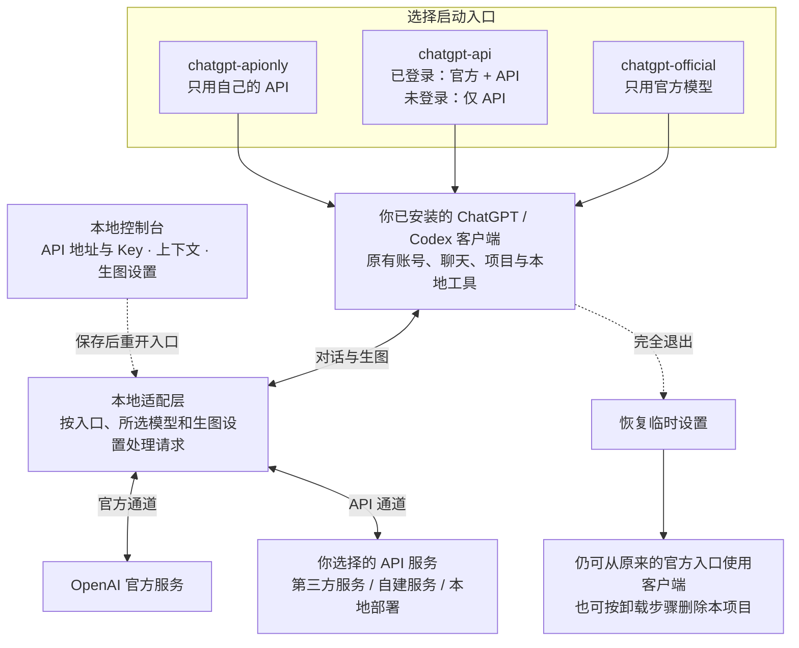

# ChatGPT API Launcher

### 在你最熟悉的官方客户端里，用上自己的 API

喜欢官方桌面端的丝滑交互和原生快捷键，但又想接入第三方或本地大模型？  
这个工具不破坏、不篡改你的官方客户端，只是在它旁边多加了几个启动入口。想用 API 时从这里进；不想用了，关掉软件就能随时切回原版。

**原生界面与快捷键 · 官方 / 混合 / 纯 API 三模式 · 同一对话无缝切模型 · 完整保留生图与本地工具**

[你的客户端照常保留](#你的客户端照常保留) · [核心优势](#核心优势) · [快速开始](#快速开始) · [三大启动模式详解](#三大启动模式详解) · [生图与视觉能力](#生图与视觉能力) · [本地控制台](#本地控制台) · [架构图](#架构图) · [停用与卸载](#停用与卸载) · [常见问题 (FAQ)](#常见问题-faq) · [与同类方案对比](#与同类方案对比)

---

## 你的客户端照常保留

很多人折腾第三方套壳软件，最头疼的就是界面用不惯、历史记录要搬家，或者担心魔改补丁把原版客户端搞崩。

**ChatGPT API Launcher** 的思路完全不同：它是你电脑里已有 **ChatGPT / Codex 官方客户端** 旁边的“外挂启动器”。安装后，你用的依然是原来那个客户端，不用换软件，更不用迁移半条聊天记录。

- **零文件侵入，绝不篡改原版**  
  原版客户端的可执行文件、`app.asar` 核心包以及官方桌面快捷方式原封不动。官方客户端平时怎么升级，以后还怎么升级（大版本更新后若遇到兼容问题，同步更新一下启动器即可）。
- **原有账号、偏好与项目分类全保留**  
  配置 API 前不需要特意登出官方账号；如果你只跑纯 API 模式，甚至连官方账号都不用登录就能直接调模型聊天。
- **即开即用，关掉就回原版**  
  所有适配仅在当次运行期间生效。只要完全退出客户端，启动器会自动还原所有临时配置。下一次你直接双击官方图标打开，它就还是那个纯正的原版客户端。
- **不留残余，随时干净卸载**  
  哪天不想用了，先正常退出客户端并确认原版能正常打开，然后直接把本项目的启动器、控制台和安装目录删掉就行。不用重装官方客户端，本地聊天记录也毫发无损。

> [!NOTE]
> **切回原版客户端能正常用，但并不代表所有 API 聊出来的记录都能直接在原版里接着发消息。**  
> 那些通过自定义 API 创建、或者中途混用过第三方模型的对话，原版客户端可能无法直接续聊，需要通过本项目提供的兼容入口才能继续。卸载启动器不会弄丢这些记录，但会停用对它们的兼容支持。具体细节可看文末的 [历史对话会怎样](#历史对话会怎样)。

---

## 核心优势

- **原汁原味的官方交互，自由接入各路模型**  
  完整保留官方客户端的 UI 质感、全局快捷键、文件拖拽和项目（Projects）管理。只要提供 OpenAI 兼容接口，无论是 DeepSeek、Claude、Gemini、通义千问，还是自建中转、本地跑的 Ollama / vLLM，都能直接塞进官方界面里用。
- **同一个对话窗口，官方与 API 模型混着切**  
  登录了官方账号后，模型下拉菜单会把官方模型和你的自定义 API 模型列在一起。简单问题用便宜 API，复杂推理切旗舰模型，全程在同一个对话里无缝接力，不用为了换模型反复重开新窗口。（*注：涉及图片、特定附件或已被官方深度压缩的旧对话，切换时仍受目标模型本身的能力限制*）
- **官方额度见底？切自己的 API 接着聊**  
  到了月末或高峰期官方额度用完时（v3.2.5 已支持），不用干等恢复，直接在原对话里切到自己的 API 模型就能继续发消息。消耗的是你自己的 API 余额，不会改动或触碰官方账号本身的额度计算。
- **多达 32 个 API 来源集中管理**  
  手头有好几家服务商？控制台最多支持同时配置 32 个来源，随时单独命名、启用或停用。客户端模型列表会自动带上来源后缀，哪怕不同渠道有同名模型也分得清清楚楚，绝不串台。
- **聊天记录与项目归属感完全不断裂**  
  无论你在本项目的哪个启动入口之间来回切换，看到的都是同一套本地聊天记录、项目文件夹和分类映射，不会给你额外拆分出一套割裂的外部数据库。
- **原生本地工具与思考过程（Reasoning）照常工作**  
  客户端自带的本地文件读写、终端调用等工具依然可用，服务商返回的模型思考链（Reasoning / Thinking）也能在界面上原生折叠展示。当然，具体能调起哪些工具，最终取决于客户端状态、系统权限以及你选的模型本身支不支持。
- **聊天、画图、上下文参数一处搞定**  
  在本地控制台就能统一调配 API 渠道、默认生图模型、画质、图片思考强度以及上下文窗口上限。对于支持的服务商，GPT 系列模型还能直接点亮客户端里的 Fast（小闪电）加速开关。
- **开箱即用，告别繁琐的环境配置**  
  全平台安装包均已内置独立的轻量级 Node 运行时，不需要你在电脑上折腾开发环境。装好填上 URL 和 Key 就能跑；甚至安装时可以先跳过配置，进桌面后再慢慢填。

---

## 快速开始

### 1. 下载发布包

> [!NOTE]
> 本项目是启动与适配层，**不包含官方客户端本体**，请确保电脑上已经安装并能正常运行 **ChatGPT / Codex 桌面客户端**。Windows 和 macOS 提供完整的三个启动入口；Linux 目前提供纯 API 模式与控制台。

在安装启动器之前，建议先把官方客户端更新到最新稳定版。目前 **Windows 端已验证的版本为 `26.1106.6628.0`**（建议使用该版本或更新版；旧版 `26.1029.9216.0` 曾出现过启动超时，升级客户端后即解决，此处仅作经验参考而非官方硬性门槛）。macOS 与 Linux 请使用各自平台的最新稳定版客户端。如遇客户端更新问题，可查阅[官方排查说明](https://learn.chatgpt.com/docs/reference/troubleshooting)。

| 平台 | 下载地址 | 安装说明 |
| :--- | :--- | :--- |
| **Windows x64** | [ChatGPT-API-Launcher-3.2.5-win-x64.zip](https://github.com/bolifa556/ChatGPT-API/releases/download/v3.2.5/ChatGPT-API-Launcher-3.2.5-win-x64.zip) | 解压后双击运行 `安装.cmd`，按提示选好目录即可完成安装。 |
| **macOS (Apple Silicon)** | [ChatGPT-API-Provider-3.2.5-macos-arm64.dmg](https://github.com/bolifa556/ChatGPT-API/releases/download/v3.2.5/ChatGPT-API-Provider-3.2.5-macos-arm64.dmg) | 打开 DMG，把需要的启动入口和控制台 App 拖进“应用程序”。首次打开若遇系统弹窗拦截，请按 [macOS 说明](docs/macos-dmg-readme.md) 放行。 |
| **Linux x64** | [ChatGPT-API-Provider-3.2.5-linux-x64.tar.gz](https://github.com/bolifa556/ChatGPT-API/releases/download/v3.2.5/ChatGPT-API-Provider-3.2.5-linux-x64.tar.gz) | 解压后，在桌面用户权限下运行 `./install.sh`。（详见 [Linux 说明](docs/linux-readme.md)） |
| **Linux ARM64** | [ChatGPT-API-Provider-3.2.5-linux-arm64.tar.gz](https://github.com/bolifa556/ChatGPT-API/releases/download/v3.2.5/ChatGPT-API-Provider-3.2.5-linux-arm64.tar.gz) | 解压后同样直接运行 `./install.sh` 即可。 |

### 2. 填写自己的 API

安装过程中如果还没准备好 Key，可以直接点 **“跳过，稍后配置”**（覆盖安装时原有的 API 配置会自动保留；如果你只打算用官方兼容入口，不填 API 也能用）。

装好之后，打开 **本地控制台**（比如 Windows 下双击安装目录里的 `控制台.vbs`）按下面四步走：

1. 切到 **API 来源** 页面，新增一个来源，填好自定义名称、Base URL 和 API Key。
2. 点击 **保存**，接着切到 **模型与上下文** 页面，点一下右上角的 **刷新模型目录**。
3. 检查拉取出来的模型列表。如果你需要画图功能，确认列表里已经识别出图片模型（系统会自动帮你勾选一个默认生图模型，你也可以手动换别的）。
4. **完全退出**当前正在运行的客户端，然后双击你需要的启动入口，即可开始聊天。

> [!TIP]
> Base URL 请填写服务商提供的 OpenAI 兼容接口地址。由于各家服务商对接口的实现程度不一，能刷出模型名字不代表所有高阶特性（如工具调用、识图）都能完美跑通。另外，如果你连的是本地免鉴权服务（如本地 Ollama），目前 Key 这一栏也请随便填个非空字符占位。

### 3. 选择启动入口

Windows 和 macOS 安装好后会有三个不同的启动入口。**注意：每次切换不同入口之前，请务必先把客户端彻底退干净（包括 Windows 右下角系统托盘里的后台图标）。**

---

## 三大启动模式详解

你可以根据当下的使用习惯，挑一个最顺手的入口启动：

| 启动入口 | 什么时候用它？ | 实际体验与效果 |
| :--- | :--- | :--- |
| **`chatgpt-official`** | 只想用官方账号和官方模型，但希望顺畅查看、续聊以前用 API 聊过的对话 | 保持官方登录状态，只加载官方模型，无需配置 API。它是带了历史对话兼容层的“官方模式”，比直接裸开原版客户端多了一层对旧 API 记录的兼容。 |
| **`chatgpt-api`** | 官方 Plus/Pro 订阅和自己的 API 掺着用 | 登录官方账号时，下拉菜单同时列出官方模型和 API 模型，同一对话随便切；未登录时则只走 API。 **亮点：官方额度刷爆后，可直接切自定义模型继续聊。** |
| **`chatgpt-apionly`** *(Linux 名为 `ChatGPT API`)* | 彻底脱离官方订阅，100% 纯用自己的 API | 不管客户端里有没有保存官方登录态，所有对话和生图请求全部走你配置的 API，模型列表里也只显示你自己的 API 模型。 |

- **独立记忆模型选择**：Windows 和 macOS 下，两个 API 入口会分别记住你上一次选中的可用模型。
- **无缝继承偏好**：客户端的界面语言、深浅色主题、项目文件夹分类等全部沿用你原来的设置。
- **随时回归原版**：如果哪天不想走这三个入口了，把客户端彻底退掉，直接点回官方原本的图标就行，不用做任何切换开关。

---

## 生图与视觉能力

只要你接入的渠道支持生图或视觉模型，就能直接在官方聊天框里让模型画图、看图说话，或者对着画好的图提修改意见。

### 自动识别生图模型，省去挑拣烦恼
在控制台点击“刷新模型目录”后，程序会自动把识别出的生图模型归入 **模型与上下文** 列表，并顺手帮你勾选好一个默认项。想换其他模型画图时，去控制台改勾另一个默认项，保存并重开客户端即可。

> [!NOTE]
> 目前生图模型的切换必须在本地控制台里修改默认项。直接在聊天框里打字说“请用某某模型帮我画张图”，是无法可靠触发底层模型切换的。

### 官方生图与自定义 API 生图自由选
在混合模式下，控制台允许你分别配置 **官方生图设置** 和 **自定义生图设置**：
- **官方生图设置**：直接调用你已登录官方账号的生图服务。如果官方生图报错，客户端会原样展示官方错误提示，不会悄悄拿你的第三方 API 去兜底，账目清清楚楚。
- **自定义生图设置**：调用你在列表里指定的默认 API 生图模型，并支持针对该模型微调画质档位与思考强度（Reasoning Effort）。
- 至于另外两个纯粹的入口：`chatgpt-apionly` 永远走自定义 API 生图，而 `chatgpt-official` 永远走官方生图。

### 画完接着聊，多轮看图与改图
- **原对话直接追问**：画出来的图片可以直接留在当前对话里继续讨论或要求修改，不用为了追问重新开新帖（当然，连续识图和改图需要你当前选用的聊天模型、生图模型及后端服务商同时支持对应能力）。
- **常见格式与动图保留**：完整支持 PNG、JPEG、WebP 格式，如果后端生图服务返回的是 GIF 动图，客户端也会原样保留 GIF 文件。
- **关于能力的实在话**：客户端能保存 GIF，不代表随便接个模型就能生成动图——能不能出 GIF、支不支持特定画质档位，完全取决于你接的 API 服务商底层给没给这个能力。

---

## 本地控制台

所有的 API 渠道、模型开关和参数微调，都收敛在一个运行在本机的轻量级网页控制台里，不用在电脑上额外装一套臃肿的管理软件。

| 平台 | 怎么打开控制台？ | 默认安装路径参考 |
| :--- | :--- | :--- |
| **Windows** | 双击安装目录下的 `控制台.vbs` | `%LOCALAPPDATA%\Programs\ChatGPT-API-Launcher` |
| **macOS** | 打开 `chatgpt-console.app`，或运行目录里的 `控制台.command` | `~/Library/Application Support/chatgpt-apionly` |
| **Linux** | 运行目录里的 `控制台.desktop`，或在应用菜单搜索 **ChatGPT API 控制台** | `~/.local/share/chatgpt-api-provider` |

### 控制台里都能干什么？
- **打理 API 渠道**：添加、修改多达 32 个 API 来源的名称、地址与 Key，随时一键启用或停用某个渠道。
- **拉取模型目录**：手动刷新并查看各个渠道当前能提供哪些可用模型。
- **设置画图参数**：指定默认生图模型，并调节它支持的画质与思考强度（若接口未返回相关能力信息，界面会如实标注“无法检测”）。
- **微调上下文上限**：支持调整全局或单个模型的上下文窗口上限。系统默认上限设为 500,000 tokens（客户端界面内通常折算显示为约 475k）；你可以在 `4,096` 到 `2,000,000` 之间自由设定，不过实际生效值不会突破模型已知的容量上限。
- **Key 掩码防窥**：保存后的 API Key 默认以密码圆点遮挡，需要核对时点一下旁边的小眼睛图标就能查看明文。

### 贴心的本地缓存与自动退出
- **24 小时模型列表缓存**：刷新出来的模型目录会在本地缓存 24 小时。哪怕某天服务商的列表接口临时抽风刷不出来，客户端依然能靠缓存正常加载模型菜单（当然，真正发消息聊天时 API 服务肯定得在线）。软件运行期间不会在后台偷偷发定时请求去刷列表。
- **用完即走，不占后台**：当你关掉浏览器的最后一个控制台标签页后，控制台进程会在几秒内自动退出，绝不常驻吃内存。而负责转发聊天请求的轻量后台服务，则会在你彻底退出 ChatGPT 客户端后跟着自动结束。

> [!TIP]
> 每次在控制台改完配置或重新刷新模型目录后，别忘了**彻底退出客户端再重新从对应入口打开**，这样新配置才会真正生效。

---

## 架构图

无论你点开哪一个入口，底层跑的都是你电脑里原本那套官方客户端。本地适配层只负责在中间按你的配置分发模型与生图请求，原有的账号数据、聊天记录和界面设置完全不受影响。

*(注：Windows 与 macOS 提供全部三个入口，Linux 提供纯 API 模式。官方入口纯走官方通道，纯 API 入口纯走自定义通道；混合入口下生图走哪条通道可在控制台自由指定。)*

---

## 停用与卸载

### 临时不想用了，怎么切回原版？

1. 把客户端**彻底退出**（注意检查系统托盘，确保后台进程已关闭）。
2. 直接点击你平时用的**官方原版图标**打开客户端。
3. 就像没装过本项目一样照常使用即可。你配好的 API 信息依然安静地留在启动器目录里，下次想用时再从启动器入口进就行。

**整个过程不需要重装官方客户端，更不需要登出账号、清空历史聊天或重新整理项目文件夹。**

### 打算彻底卸载，怎么删才干净？

1. 先把客户端和本地控制台全部彻底退出。
2. 从官方原版入口打开一次客户端，确认一切正常后再退出来。
3. 直接删掉本项目生成的启动入口快捷方式、控制台以及安装目录即可（macOS 用户顺手把拖进“应用程序”里的那几个启动器 App 移到废纸篓就行）。

**卸载前的几个实用提醒：**

* **配置备份与防泄漏**：如果以后还可能重装，可以把安装目录下的 `data` 文件夹拷出来留个备份。注意 `data` 里面存有明文 API Key，千万别随手发给别人或传到公开网盘；如果不打算再用了，连同安装目录直接粉碎即可。
* **各删各的，别误伤原版**：卸载时只删本项目自己的目录就行，**千万不要**去删官方客户端的安装目录，也不要去清理官方客户端的用户数据目录，这样你所有的本地聊天记录都会完好保留。
* **遇到意外断电/强退后的恢复**：如果之前电脑突然蓝屏断电、或者你用任务管理器强行杀过进程，导致弹出恢复失败的提示，请先别急着删目录。随便用本项目的任意入口正常打开一次客户端，再正常点退出，让它走完自动还原流程；确认官方原版入口能正常打开后，再去删文件夹。

### 历史对话会怎样？

* **纯官方对话**：原本就是用官方入口聊出来、且符合原版格式规范的对话，切回原版后依然可以正常查看和继续聊天。
* **API 参与过的对话**：那些用自定义 API 创建、或者中途切过第三方模型的对话，直接回原版客户端可能会无法继续发送消息。
* **记录不丢，按需留入口**：卸载启动器绝对不会删掉这些历史对话记录，只是没了启动器的兼容层后，原版客户端没法直接接着聊它们。如果你手头还有很重要的 API 历史长对话需要继续跟进，建议先保留 `chatgpt-official` 兼容入口；等确认这些旧对话不再需要续聊了，再彻底删除本项目。

---

## 常见问题 (FAQ)

<b>一定要登录官方账号吗？</b>

> 不需要。如果你只想用自己的 API 聊天和画图，直接走 `chatgpt-apionly`（纯 API 入口）就行，完全不用登录官方账号。只有当你需要调用官方订阅模型时，才需要登录官方账号。另外提醒一下，客户端里部分依赖官方云端的特性（如特定的浏览器扩展联动、官方原生高级语音等）认的是官方账号权限，填模型 API Key 是没法解锁这些官方专属权限的。

<b>官方额度用完，还能用自己的 API 吗？</b>

> 完全可以。当前的 3.2.5 版本已经支持在 `chatgpt-api`（混合入口）下，当官方额度耗尽时直接在原对话切到自定义 API 模型继续发消息；或者你也可以彻底退出客户端，改从纯 API 入口进。当然，前提是你配置的 API 本身余额充足且服务正常（若遇到客户端权限锁死或特殊任务状态限制，则仍受客户端本身的规则约束）。

<b>用过 API 后，原来的客户端还能独立使用吗？</b>

> 随时可以。只要正常彻底退出客户端，启动器所做的临时引导设置就会自动还原。之后你直接点官方图标就能独立运行原版，不需要后台挂着本项目。唯一需要注意的是部分 API 历史对话在原版里续聊会有格式限制，具体见上面的 [历史对话会怎样](#历史对话会怎样)。

<b>为什么有些模型不能识图、用工具或生成图片？</b>

> 因为这些高阶能力需要 **客户端界面 + 你的 API 转发服务商 + 底层大模型本身** 三方同时支持才能跑通。能从接口刷出模型名字、能普通打字聊天，不代表服务商把视觉识别、Function Calling（工具调用）或生图接口也全部对齐了；同样，切换到一个纯文本模型，也不会让它凭空长出识图或画图的能力。

<b>历史对话切换模型后，一定都能接着聊吗？</b>

> 绝大多数普通文本对话，在本项目的兼容入口里都可以随时换模型接着聊。但如果某段旧对话已经被官方服务端做过深度上下文压缩，或者里面夹杂了其他第三方服务无法解析的专属附件，此时切到非 GPT 模型可能会遇到阻碍。在底层机制上，`chatgpt-official` 入口沿用官方原生的压缩逻辑，而两个 API 入口则采用客户端本地的文字摘要压缩（感兴趣的开发者可查阅技术文档了解细节）。

<b>我的 API Key 会发到哪里？</b>

> 所有的配置和 Key 都只保存在你自己的电脑本地，请求模型目录、聊天或生图接口时，程序会把对应的 Key 发给你所选的 API 服务商做鉴权。需要注意：**Key 在本地配置文件中是以明文存储的**，控制台网页上的圆点只是前端视觉遮挡。因此，如果你要把这个工具安利给朋友，请直接分享官方 Release 下载包，千万别把自己已经填好 Key 的安装目录打包发出去！

<b>所有标注“OpenAI 兼容”的 API 都能用吗？</b>

> 不一定百分百全功能可用。市面上很多中转或本地框架虽然号称“OpenAI 兼容”，但往往只兼容了最基础的 `/v1/chat/completions` 对话接口。本项目要完整跑通模型拉取、流式对话、画图、修图以及本地工具调用，需要服务商把对应的接口规范都实现到位。如果遇到部分功能报错，可能需要服务商侧做相应适配（本地部署同理）。具体的接口协议要求可以翻看 [配置说明](docs/configuration.md)。

---

## 与同类方案对比

开源社区里有不少围绕 Codex 和桌面端打造的优秀工具，侧重点各有不同，你可以按自己的核心诉求来挑：

| 项目 | 核心定位与适用场景 |
| --- | --- |
| **本项目 (ChatGPT API Launcher)** | **适合钟情官方原生桌面端体验的用户**：不动原版文件，直接给现有官方客户端加上“官方 / 混合 / 纯 API”三个启动模式，在同一套聊天记录和项目里混用各路模型，不想用了随时关掉回原版。 |
| **[Codex++](https://github.com/BigPizzaV3/CodexPlusPlus)** | 适合希望统一编排多个 Agent、需要更丰富的插件扩展、UI 界面增强以及内置本地网关能力的玩家。 |
| **[OpenCodex](https://github.com/lidge-jun/opencodex)** | 适合手里同时用着 Codex、Claude Code 等多个不同客户端，希望在底层让它们共用同一套模型后端服务的用户。 |
| **[CC Switch](https://github.com/farion1231/cc-switch)** | 适合需要在不同开发工具之间集中切换 API 供应商，并统一打理 MCP、Skills 以及系统提示词（Prompts）配置的重度用户。 |

---

## 更多文档

想深入了解各平台安装细节或底层实现，可以继续阅读：

* [macOS 安装与更新](docs/macos-dmg-readme.md)
* [Linux 安装与使用](docs/linux-readme.md)
* [控制台使用说明](docs/console.md)
* [技术架构与协议机制](docs/architecture.md)
* [技术文档索引](docs/README.md)
* [开发与构建](docs/maintenance.md)

---

## 免责声明

* 本项目为独立的第三方开源工具，仅供技术交流与个人学习使用，安装包内不包含、也不分发任何 OpenAI 官方客户端软件。
* 文中提及的“ChatGPT”、“OpenAI”及相关图形标识，其商标与著作权均归原权利人所有。
* 使用本项目接入各类 API 时，请自觉遵守对应 API 服务商的服务条款以及你所在地区的法律法规。

---
